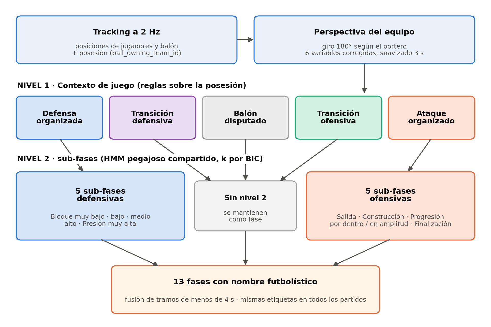
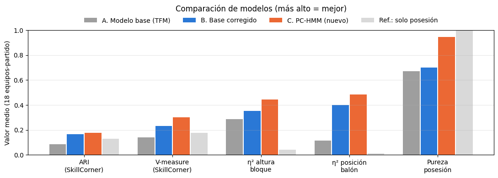

# Identificación de fases tácticas en fútbol con clustering y datos espaciales de alta frecuencia

Trabajo Fin de Máster · Máster en Big Data y Ciencia de Datos · Universidad Internacional de Valencia
Autor: Álvaro de la Puente Orozco · Director: Carlos Cruz de la Torre

Este repositorio contiene el código completo del TFM. El objetivo es identificar de forma automática las fases tácticas por las que pasa un equipo durante un partido, a partir de datos abiertos de tracking (posición de los 22 jugadores y del balón varias veces por segundo).

Se construyen y comparan dos modelos de aprendizaje no supervisado:

- **Modelo base.** K-means para fijar el número de estados y un HMM gaussiano para ordenarlos en el tiempo, ajustados por separado en cada partido y equipo. Converge siempre a dos estados, que se interpretan como defensa y ataque.
- **PC-HMM** (*Possession-Conditioned Hidden Markov Model*). Modelo propio en dos niveles. El primero sitúa cada instante en un contexto de juego con reglas sobre la posesión del balón (ataque, defensa, transiciones y balón disputado). El segundo divide el ataque y la defensa organizados en sub-fases con un HMM "pegajoso" compartido por todos los partidos. El resultado son 13 fases con nombre futbolístico, iguales en todos los partidos.



## Resultados principales

Media de los 18 equipos-partido (tabla completa en [`results/tabla_comparativa_modelos.csv`](results/tabla_comparativa_modelos.csv)):

| Criterio | Modelo base | PC-HMM |
|---|---|---|
| Nº de fases | 2 | 13 |
| ARI frente a SkillCorner | 0,087 | 0,178 |
| V-measure frente a SkillCorner | 0,140 | 0,302 |
| η² altura del bloque | 0,286 | 0,445 |
| η² posición del balón | 0,116 | 0,483 |
| Pureza de posesión | 0,671 | 0,947 |
| V-measure en partidos no vistos | — | 0,299 |



## Estructura del repositorio

```
├── notebooks/
│   └── TFM.ipynb                  # Notebook completo, ya ejecutado
├── results/
│   └── tabla_comparativa_modelos.csv
├── figures/                       # Figuras principales de la memoria
├── data/README.md                 # Origen de los datos (no se redistribuyen)
├── requirements.txt
└── LICENSE
```

El notebook se organiza en siete secciones que siguen el orden del pipeline:

| Sección | Contenido | Funciones principales |
|---|---|---|
| 5.1 | Configuración global del experimento | — |
| 5.2 | Carga de los nueve partidos con kloppy y unificación | `reshape_skillcorner()` |
| 5.3 | Variables individuales y colectivas por partido, equipo y frame | `calcular_variables_individuales()`, `calcular_variables_colectivas()` |
| 5.4 | Modelo base: K-means, HMM y fusión de segmentos cortos | `elegir_k()`, `segmentar_temporal()`, `extraer_fases()` |
| 5.5 | Validación interna y externa frente a las Phases of Play de SkillCorner | `cargar_fases_reales_skillcorner()`, `construir_etiqueta_real()` |
| 5.6 | Visualización de resultados del modelo base | `dibujar_frame()` |
| 5.7 | PC-HMM y comparación entre modelos | `construir_perspectiva()`, `contexto_de_juego()`, `hmm_pegajoso()`, `bic_hmm()`, `nombrar_estados()`, `entrenar_pc_hmm()`, `aplicar_pc_hmm()` |

## Cómo ejecutarlo

En Google Colab: abrir `notebooks/TFM.ipynb`, instalar las dependencias en la primera celda (`!pip install kloppy hmmlearn`) y ejecutar todas las celdas en orden.

En local:

```bash
git clone https://github.com/alvarodlpo/tfm-fases-tacticas-futbol.git
cd tfm-fases-tacticas-futbol
python -m venv .venv && source .venv/bin/activate
pip install -r requirements.txt
jupyter notebook notebooks/TFM.ipynb
```

Los datos se descargan automáticamente desde el repositorio de SkillCorner al ejecutar la sección 5.2, así que hace falta conexión a internet. La ejecución completa tarda unos minutos.

## Datos

[SkillCorner Open Data](https://github.com/SkillCorner/opendata), licencia MIT. Se usan los nueve partidos con estado "closed" de la A-League australiana 2024/25. Más detalle en [`data/README.md`](data/README.md).

## Licencia

Código bajo licencia MIT. Los datos pertenecen a SkillCorner y se usan según su propia licencia.
